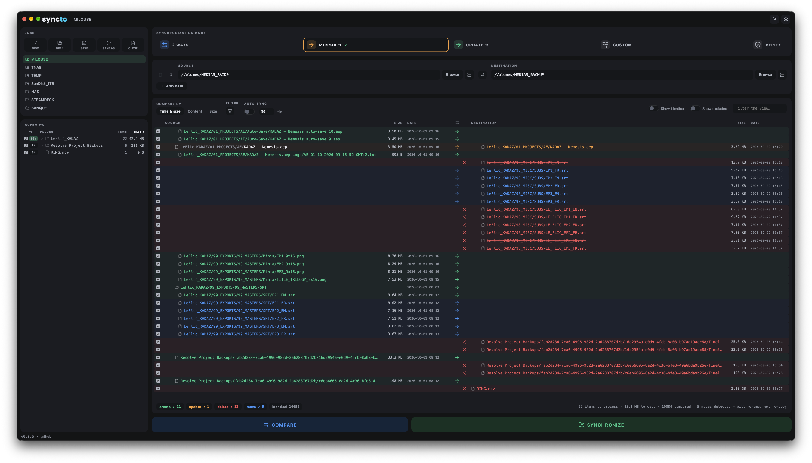

# syncto
### Folder comparison and synchronization — by Just Edit

Open-source folder sync for video and audio professionals. Same feature set as
FreeFileSync, rebuilt from scratch with the ingesto interface: progress ring,
live throughput graph, ETA, and a checksum-verified copy that reads every file
back.

**macOS · Windows · Linux** (AppImage and `.deb`).

Licensed under the **GNU General Public License v3.0** (see [`LICENSE`](./LICENSE)).

---

## Screenshots



<sub>The main window in 0.8.5: a Mirror between two folders, compared. Creations
in green, updates in orange, deletions in red, moves in blue.</sub>

---

## What it does

| | |
|---|---|
| **Compare** | by modification time and size, byte for byte, or by size only |
| **Synchronize** | 2 Ways, Mirror, Update, or a Custom rule per category |
| **Compare only** | the COMPARE mode browses both sides in two panels and shows what differs; a right-click copies chosen items to the other side, nothing else is ever written |
| **Multi-pair** | one job synchronizes any number of folder pairs, FreeFileSync-style |
| **Moved files** | a rename is detected and replayed as a rename — no re-copy |
| **Verified copy** | one mode: every file read back and compared (xxHash64), with an optional checksum sidecar |
| **Deletion** | trash or permanent — always announced, never silent |
| **Filter** | per-job include/exclude patterns, name- or path-anchored |
| **Reveal** | right-click any row or folder field → open it in Finder / Explorer, either side |
| **Locking** | one machine at a time per folder, safe over any network share |
| **Remote** | local disks, mounted network shares, SFTP, FTP and FTPS |

---

## Quick install (no coding knowledge required)

### Step 1 — Install Node.js
Go to **https://nodejs.org**, click the green **LTS** button, run the installer.

### Step 2 — Download syncto
`git clone https://github.com/noar-justedit/syncto.git`
(or **Code → Download ZIP** and unzip it wherever you like).

### Step 3 — Build the app
1. Open the `syncto` folder
2. **Double-click `build_mac.command`**
   - If macOS asks for confirmation, click **"Open"**
   - A Terminal window opens and builds everything automatically
   - The first run takes 2–3 minutes (downloading dependencies)
3. When it's done, the script offers to open the `dist/` folder

For Windows, **double-click `build_windows.command`** — it cross-builds from
your Mac.

Double-click only ever works on a `.command` file: macOS opens a `.sh` in a text
editor. And if a launcher ever answers **"you do not have appropriate access
privileges"**, the folder travelled somewhere that drops file permissions (a
FAT/exFAT stick, a sync from Windows, some unzip tools). Open Terminal in the
`syncto` folder and run `chmod +x *.command build.sh scripts/*.sh scripts/*.command`
once — the launchers repair themselves after that.

**Building the Windows version from a Mac works.** syncto's own code compiles
nothing — hash-wasm is WebAssembly and ssh2 is JavaScript. ssh2 does declare two
*optional* native modules, which npm installs on any Mac carrying the Xcode
command line tools; `electron-builder.yml` skips the rebuild pass and leaves
them out of the package, because nothing here needs them. The portable `.zip`
needs nothing extra; the `.exe` installer is assembled by Wine, so install it
once with `brew install --cask wine-stable` if you want it.

### Signing and notarization (macOS)

**There is nothing to run first.** The macOS build does all of it — double-click
`build_mac.command`, or run `./build.sh`, and that is the whole
procedure, now and for every build after.

With a **Developer ID Application** certificate in your keychain it signs the
app, sends it to Apple, and attaches the returned ticket to both the app and the
disk image. It then opens with a plain double-click on any Mac, with no internet
connection needed on first launch.

The **first** signed build asks two questions: your Apple ID, and an
**app-specific password** — made at appleid.apple.com → *Sign-In and Security* →
*App-Specific Passwords*, which is not the same thing as your Apple ID password.
Both go into the macOS keychain through `xcrun notarytool store-credentials`,
under the name `syncto-notarization`. They are never written into the project:
no file to add to `.gitignore`, no secret that can travel inside a release
archive. You are never asked again.

Every later build prints two green lines and gets on with it.

Nothing about this can cost you a build:

- **No certificate** → an unsigned build, exactly as before. If the only
  certificate you have is an *Apple Development* one — which signs the app
  perfectly and is then refused by every other Mac — it says so by name rather
  than reporting a vague failure.
- **Apple's command line tools missing** → signed, not notarized, with the one
  command that fixes it.
- **Apple unreachable, or the submission rejected** → the build runs again
  without notarization rather than leaving you with an empty `dist/`.
- `SYNCTO_SKIP_SIGN=1 ./build.sh` forces an unsigned build on purpose, and
  `./build.sh --sign-check` reports what you would get without building
  anything.

At the end it runs `spctl` and says what a *stranger's* Mac will do with the
file — a build that is signed but not notarized looks perfect on the machine
that made it and is refused everywhere else.

Nothing about this is mandatory. No certificate → the build produces an unsigned
app exactly as before, and `SYNCTO_SKIP_SIGN=1 ./build.sh` forces that on
purpose. The script says which of the three you got, and runs `spctl` at the end
to report what a *stranger's* Mac will do with the file — a build that is signed
but not notarized looks perfect locally and is refused everywhere else.

The Windows build is unsigned: SmartScreen warns on first launch
(**More info → Run anyway**).

From a terminal, `./build.sh` at the project root does the same:

| Command | Result |
|---|---|
| `./build.sh` | macOS Apple Silicon `.dmg`, signed and notarized when it can be |
| `./build.sh --universal` | macOS Universal (Intel + Apple Silicon) |
| `./build.sh --win` | Windows x64 — portable `.zip` + NSIS `.exe` |
| `./build.sh --all` | macOS arm64 and Windows x64 |
| `./build.sh --dev` | run without building |
| `./build.sh --test` | run the engine test suite |

### Linux

**Build Linux on Linux:** `bash scripts/build-linux.sh` on an Ubuntu, Debian or
Pop!_OS machine. It checks Node (20.19 or newer — the `apt` one is too old, the
script says how to get a current one), and writes
`dist/syncto-<version>-linux-x86_64.AppImage` and
`dist/syncto_<version>_amd64.deb`. electron-builder can produce an AppImage
from a Mac, but the `.deb` it makes there is not valid, so the Linux packages
come from a Linux machine — the same rule as ingesto.

- Install the `.deb`: `sudo apt install ./dist/syncto_*_amd64.deb`
- Run the AppImage: `chmod +x syncto-*.AppImage && ./syncto-*.AppImage`. It
  needs FUSE 2: `sudo apt install libfuse2t64` (`libfuse2` on 22.04 and older).
- **Server passwords need a desktop keyring** (GNOME Keyring or KWallet). On a
  session without one, Electron offers a "store" that is really plain text;
  syncto refuses it and asks for the password at each connection instead of
  writing it down.

### Test without building (dev mode)
Install Node.js (Step 1), then double-click `scripts/dev.command`.

### Publishing to GitHub (maintainer)
Double-click `scripts/push_github.command` in the folder to publish. It makes
the repository's `main` branch identical to the folder — additions, changes and
removals, executable bits included — except for the maintainer's working files
(`CLAUDE.md`, `AGENTS.md`, `ETAT_PROJET.md`, `test/` and `docs/`, whose
`screenshots/` stays), which are never sent — after listing the changes and
waiting for `y`. It refuses unless `version.json` and `package.json` agree on a
version higher than the one on GitHub, never forces a push, and holds
`version.json` back until the GitHub Release `vX.Y.Z` exists, because that file
is what makes every installed copy announce the update. So: run it, publish the
Release with its binaries, run it again.

It needs git (`xcode-select --install`) and Node.js. The first push asks for
GitHub credentials: either sign in once with the GitHub CLI
(`brew install gh && gh auth login`), which the script then uses, or answer
git's prompt with your GitHub user name and a personal access token (not your
password); macOS keeps it in the keychain.

### For developers and AI assistants
The project's working rules and its state (architecture, decisions and their
reasons, known issues, where the version number lives) are kept by the
maintainer in `AGENTS.md` and `ETAT_PROJET.md`, in French. They are not
published here.

---

## Using it

### The window

- **Top**: the two folders. Type a path, click **Browse**, or drag a folder from
  the Finder onto the field. The line underneath shows the free space.
- **Toolbar**: how to compare and what to synchronize.
- **Grid**: one row per item, left side on the left, right side on the right,
  the decided action in the middle.
- **Bottom strip**: how many items will be created, updated or removed.

### Typical run

1. Set the two folders
2. Choose **Mirror →** (or another variant, see below)
3. Press **COMPARE** — nothing is written yet
4. Read the grid. Click any **action cell** to change that row's direction, or
   untick a row to leave it alone
5. Press **SYNCHRONIZE**, confirm the summary

### Synchronization variants

| Variant | What happens |
|---|---|
| **Mirror →** | the right side becomes an exact copy of the left. Anything extra on the right is removed. |
| **Update →** | new and changed files are copied rightward. Nothing is ever removed. |
| **2 Ways** | both sides converge. Needs the database from the previous run to tell a deletion from a creation — the first run therefore only copies. |
| **Custom** | you decide, per category, in the settings. |

### Compare only

The **COMPARE** mode, next to VERIFY in the modes row, is for comparing two
folders or volumes without synchronizing anything. After pressing COMPARE, the
grid gives way to a tree in two panels, source and destination, both sides on
the same rows: an item missing on one side leaves a blank, hatched row there.
Folders open and close in place (chevron, double-click, Enter, Left and Right
arrows) and the two sides scroll together. **Expand differences** opens every
folder present on both sides that has differences inside; **Collapse all**
closes everything. The overview on the left opens any folder in the tree.

- **Yellow** name and icon: only on this side. **Green**: newer on this side
  (or the same date with another size, green on both sides); the older copy
  stays plain. **Grey**: identical on both sides.
- A **blue** folder with a number: that many files differ inside it.
- **All / Equal / Different** at the top show everything, only what is
  identical, or every kind of difference.
- The chips under the panels count, over the whole comparison, what is only in
  the source, only in the destination, newer on either side, different, or
  identical. A click shows that category alone. "Filter the view" searches the
  names and opens the folders on the way to what it finds.
- Click selects, double-click opens or closes a folder. Cmd-click (Ctrl-click on
  Windows and Linux) adds a row to the selection, Shift-click or Shift+arrows
  select a range, Cmd/Ctrl+A selects every row shown. Home, End, Page Up and
  Page Down move through the list; the menu key (or Shift+F10) opens the
  right-click menu.
- Right-click a row to reveal it in the Finder / Explorer, on either side.

**Copy, item by item.** Right-click a selection and choose **Copy to
destination** or **Copy to source**. A folder goes with everything inside it.
The copy adds what is missing on the other side and replaces what is older
there; it never deletes anything and never replaces a newer file, whatever
the comparison (time and size, content or size). A file with the same date
and another size is copied. Left as they are, and counted: newer files,
excluded files, a file on one side and a folder on the other, and in a TWO
WAY job the files changed on both sides since the last synchronization
(resolved in the grid). When files
are about to be replaced, a dialog says how many and where the replaced
versions go (trash, revision folder, or deleted permanently, as set in
Settings › Deletion); a copy that only adds starts at once. It is a normal run
of the engine on those rows only: same folder lock, read-back check, retries
and report as SYNCHRONIZE, and one operation at a time (a comparison asked for
during a copy waits). The panels are updated from what was copied, without
comparing everything again.

Apart from these copies, nothing is written in this mode: SYNCHRONIZE and
auto-sync are disabled, and the engine refuses a synchronization of a job in
COMPARE mode. Choosing a synchronization mode again brings back the grid and
the mode the job had. The comparison uses the same settings as always (time and
size, content, or size).

### Moved files

When you rename or move a file (or a whole folder of rushes), syncto recognizes
it by its file id and simply renames it on the other side too — a 100 GB
reorganization synchronizes in seconds, nothing is re-copied and nothing passes
through the trash. Requirements: one previous run of the pair (the ids come
from the sync database), local disks or mounted shares (SFTP and FTP expose no
file ids). When in doubt — the file changed as well as moved, ids are ambiguous
because of hard links — syncto falls back to a plain copy, which is always
safe. Switchable off in the settings.

### How a copy is verified

**syncto has one copy mode.** There is no faster setting that skips the check,
because the reason to run a folder synchroniser over rushes is to know the
second copy is the same as the first.

Every run works in two passes, like ingesto: everything is copied first, then
everything is read back from its final location and compared to the xxHash64
fingerprint taken while writing. The window shows the two passes as steps
before either starts, turns blue and reads `VERIFYING · xxHash64` during the
second, and the progress accounts for it — a run moves twice the data, and says
so.

**What that costs you:** roughly twice the time of a copy alone, and over a server
twice the network traffic, since the read-back crosses the wire too, unless the
server computes the checksum itself (see Servers). That is the
price of the summary line at the end saying every file was read back and matched.

Because verification happens after the copy, a file that fails it has already
replaced the previous version. syncto reports the error, keeps the file out of
the checksum list, and does not record it in the database, so the next run
re-examines it. The size check still happens before the rename, so a truncated
copy never takes a good file's name.

Switch on **Write checksum** in the settings to get
`syncto-checksums.txt` at the root of each target: the shield button in the
title bar re-checks a folder against it months later, without the original
source.

xxHash is not cryptographic — it detects accidental corruption, not tampering.
That is the right trade-off here: it runs at several GB/s where MD5 crawls.

### Deletion

Removing a file is the only irreversible thing syncto does, so it never does it
silently:

- **Trash** (default) — recoverable. Local volumes only.
- **Permanent** — gone.

Network shares, SFTP and FTP have no trash. There, syncto deletes permanently — and
says so in the confirmation, before the run, naming the folders concerned.

### Several machines, same folders

While a run lasts, syncto puts a `.syncto.lock` file at the root of each
synchronized folder and refreshes it every 5 seconds. Another machine starting on
the same folders **waits**, and tells you which machine and user is holding it.
A lock left behind by a crash is taken over after 12 seconds of silence — or
immediately, if the dead process belonged to your own machine.

The mechanism is FreeFileSync's, and it uses no operating-system locking: it
relies only on appending a byte and renaming atomically, which every network
share supports. Taking over an abandoned lock goes through a rename rather than
a delete, so two machines waiting on the same folder can never both start.

Switchable off in the settings — do that only if your storage refuses the extra
file.

### Filters

Per job (the funnel button), one pattern per line or separated by `|`.
One rule to remember:

| Pattern | Meaning |
|---|---|
| `*.tmp` · `thumbs.db` · `Proxies/` | no `/` → matches the item's *name*, at any depth |
| `/Rushes/A001/` · `/notes.txt` | starts with `/` → one exact path from the pair's root |
| `…/` | folders only · `…:` files only |

Right-clicking any row (grid or overview) offers ready-made patterns; Space
excludes the selection temporarily.

### Servers (SFTP, FTP, FTPS)

Click the **server button** next to *Browse* in either folder field. Enter the
protocol, the address, the port, the login, and a password (or a private key,
for SFTP); syncto connects, then lets you walk the server's folders and pick
one — or create it. The field ends up holding `sftp://user@host/path`, which
you can still type by hand if you prefer. The other forms are
`ftpes://user@host/path` (FTPS, explicit TLS, port 21), `ftps://user@host/path`
(FTPS, implicit TLS, port 990) and `ftp://user@host/path` (plain FTP).

Servers you use again are listed at the top of that window: one click fills
everything in.

**Passwords are never written to a readable file.** They go to the macOS
Keychain or the Windows credential manager, through Electron's `safeStorage`.
If a machine has no usable credential store, syncto says so and asks for the
password each time rather than storing it in the clear. Only the *path* of a
private key is stored, never the key.

Everything else works the same, including checksum verification. Where the
server can compute a checksum itself (`sha256sum` over SSH, `HASH` over FTP),
syncto asks it and compares with the one taken while writing, so nothing is
read back over the network; where it cannot, the data is read back, which makes
a run considerably slower than on a local drive. SFTP and FTP have no trash and
no inode information, so use permanent deletion there, and expect renamed
files to be re-copied rather than detected as moves.

**FTP and FTPS in particular.** Plain `ftp://` sends the password and the files
in clear: use it on a network you control. An FTPS certificate that no
authority signed (a NAS, a server of your own) is trusted the first time and
remembered; a different one afterwards is refused before the login is sent.
FTP has no atomic exclusive create and no atomic rename, so the folder lock is
best effort there: do not rely on it when several machines write the same
folder. A file's date is kept only by servers that implement `MFMT`, and
syncto says when one does not; such a server gets the files again in MIRROR
when their dates differ. Each lane uses two connections (control and
transfer); syncto counts before a run how many the server allows and uses that
many lanes, down to a single connection. A certificate signed by an authority
is remembered as such: a home-made certificate in its place is refused.

### Windows-safe names

**Settings › Main › Windows-safe names** renames, during the synchronization,
the names a Mac accepts and Windows refuses: `< > : " | ? *`, a trailing space
or dot, and device names such as CON or NUL. Each refused character becomes
`_`. Parentheses, commas, `&` and accents are legal on Windows and kept.

- *Destination only* cleans the destination (new and existing names) and
  never touches the source. The two spellings stay paired at every run.
- *Both sides* renames the source as well. Projects that point at those files
  (Premiere, Resolve, After Effects…) lose their links; the confirmation says
  so and lists them.

The file a custom folder icon leaves on a Mac (shown on a PC as "Icon" and a
strange symbol) is left out while the option is on.

### When it finishes

The power icon in the title bar offers *Do nothing*, *Quit syncto*, *Sleep* and
*Shut down*. It can be changed while the files are being copied — the choice is
read when the run ends — and it is saved with the job.

It only fires on a clean run — an error, a cancellation or a lost folder lock
leaves the machine on, so you can read what happened. And a 30-second countdown
with a **Cancel** button always comes first.

It never fires while auto-sync is on, whether the run was started by auto-sync
or by hand: the machine stays up for the next cycle.

There is no hibernate entry on purpose: macOS has no such command, and on
Windows it only works when hibernation is enabled, which it usually is not.

**Settings › Notifications** sends a message through
[ntfy](https://ntfy.sh) when a run ends — the job name, what was copied, how
long it took, and the first error if there was one. Set a server (the public
one or your own), a topic, and scan the QR code to install the app. A problem
raises the priority so the phone actually rings.

The **bell** in the title bar, left of Settings, turns these notifications on
(green bell) or off (struck-through bell) with one click. With no topic set yet,
it opens Settings on the topic field instead. The title bar reads, left to
right: bell, Settings, end action.

On the public server the topic *is* the password: anyone who knows it can read
your notifications, so make it long. Servers that require an access token are
not supported.

### When something fails

**Continue on error** (Settings) decides what happens after the first failure.
On — the default — the run works through every remaining item and lists the
failures at the end. Off, it stops there, writes its database, and tells you
why: the right choice for a run you are watching.

**Retries** are separate and always apply: a failing item is attempted the
configured number of times before it counts as a failure at all.

A folder that cannot be *read*, or a base folder that is not there, is never
treated as an empty folder — that would make a mirror delete the healthy side.
Such a run is refused, with the path that needs fixing.

### Jobs

**⌘S** saves the folder pairs and every setting as a `.syncto` file — the file
name IS the job name. **⌘O** opens one; recent jobs live in the left panel.
A job can hold any number of folder pairs (ADD PAIR), all sharing the same
settings, compared and synchronized in one go.

### Keyboard

| | |
|---|---|
| `F5` | Compare |
| `F9` | Synchronize |
| `⌘T` | Swap the two sides |
| `⌘N` `⌘O` `⌘S` | New / open / save job |
| `Esc` | Close the open dialog |

---

## Files syncto writes

| File | Where | Why |
|---|---|---|
| `.syncto.db` | root of both folders | the last synchronized state, for two-way sync and move detection. Hidden, gzipped. Delete it and two-way sync restarts from scratch. |
| `.syncto.lock` | root of each folder, while running | who is synchronizing right now. Removed at the end; reclaimed automatically after a crash. |
| `syncto-checksums.txt` | root of each target | the checksum list, when **Write checksum** is on (merged run after run) |
| `*.syncto_tmp` | next to a file being written | fail-safe copy. A leftover means a run was interrupted; the comparison ignores it and the next synchronization removes it, reporting how much space it reclaimed. |
| `*.syncto_old` | next to a file being replaced, on SFTP and FTP | the previous version, parked for the instant it takes to rename its replacement into place. SFTP and FTP cannot replace a file atomically, and deleting the target first would lose it if the connection dropped. Swept like any leftover. |
| `install-id` | `~/.syncto/` | identifies this installation to the directory lock, so two machines sharing a hostname cannot mistake each other's lock for their own. Delete it and a new one is generated. |

---

## Files syncto never touches

Neither side of a comparison ever shows these, and they are never copied:
`.DS_Store`, `Thumbs.db`, `desktop.ini`, `.Spotlight-V100`, `.fseventsd`,
`.TemporaryItems`, `.DocumentRevisions-V100`, `System Volume Information`,
`$RECYCLE.BIN`, `.Trashes`, and syncto's own `.syncto.*` files.

When a folder holding one of them has to be **removed**, the operating system's
own bookkeeping folders go with it — `System Volume Information` and friends are
recreated by the volume on the spot if it still wants them. **`.Trashes` and
`$RECYCLE.BIN` are not**: they hold files somebody deleted and may want back, so
a folder containing one is left alone and the reason is reported.

Anything else still in the folder — a file your exclusion filter hides, a
symbolic link — stops the removal, on purpose, and syncto names it.

---

## Testing the engine

```bash
npm test
```

Creates real folders in a temporary directory and runs the whole engine against
them: filters, comparison categories, the four variants, the two-way database,
checksum verification, versioning, fail-safe copy and the folder rules.

The suite (`test/`) is kept with the maintainer's working files and is not
published in this repository.

It also reads the build scripts and checks every option they pass to Apple's
`notarytool` and `stapler` against the documented ones. That is a strange thing
for an engine test suite to do, and it earns its place: an invented flag makes
notarytool reject the command line before it ever reaches Apple, which looks
exactly like a wrong password, and no amount of mocking `xcrun` will catch it.

---

## Updates

At startup syncto quietly checks `version.json` on this repository (same
mechanism as ingesto). If a newer release exists, a small dismissible notice
offers to open the releases page. Nothing is downloaded automatically, the
check never blocks startup, and dismissing a version silences it for good.

---

## Converting FreeFileSync jobs

```bash
node scripts/ffs-convert.js MyJob.ffs_gui [more…] -o converted/
```

One `.syncto` per FreeFileSync configuration, all folder pairs included.
Variants, filters and retry settings are translated; FFS versioning falls back
to the trash.

---

## What is not there yet

- Real-time folder watching (the RealTimeSync equivalent)
- Batch jobs from the command line

---

## Contributing

Pull requests welcome — read [`CONTRIBUTING.md`](./CONTRIBUTING.md) first. The
short version: `npm test` must stay green, engine changes need a test, and
contributions are GPL-3.0-or-later like the rest.

Security issues: see [`SECURITY.md`](./SECURITY.md).

---

## Credits

The behaviour is modelled on [FreeFileSync](https://freefilesync.org) by Zenju,
also GPLv3 — the comparison categories, the four variants and the versioning
schemes follow it closely so that habits transfer. No FreeFileSync code is used;
syncto is written from scratch in JavaScript on Electron.

App icon by Just Edit. Interface font: Poppins (SIL Open Font License).

The icon is generated from `build-resources/icon.svg`. After editing that file,
run `./scripts/make-icon.sh` on macOS, or `python3 scripts/gen-icons.py`
(`pip install cairosvg pillow`) on any platform, to rebuild the `.icns`, `.ico`
and PNG sets that the installers embed.
